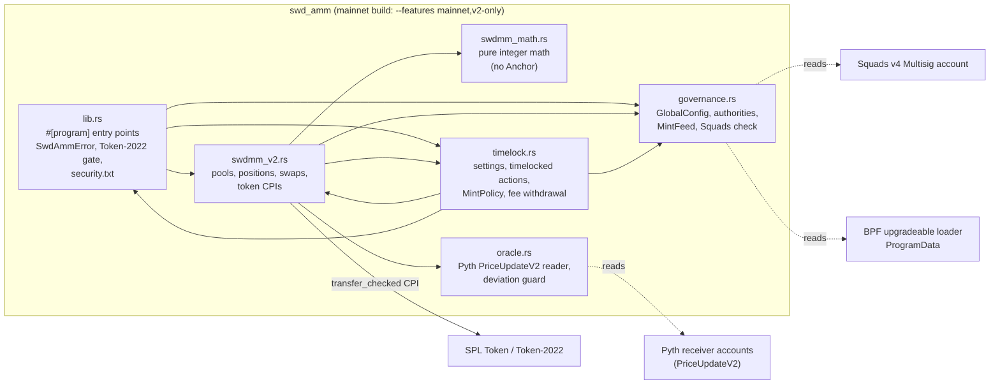
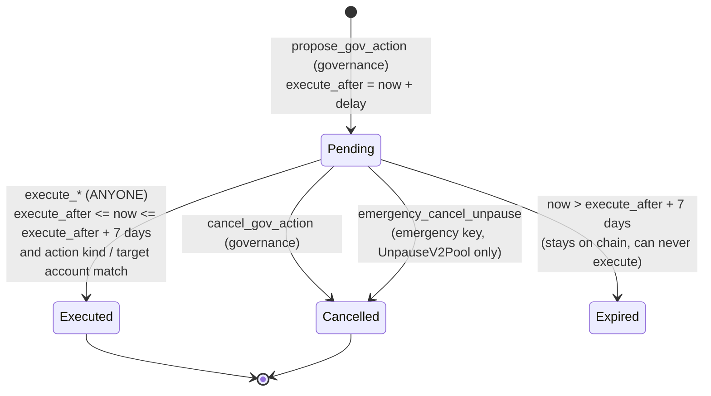
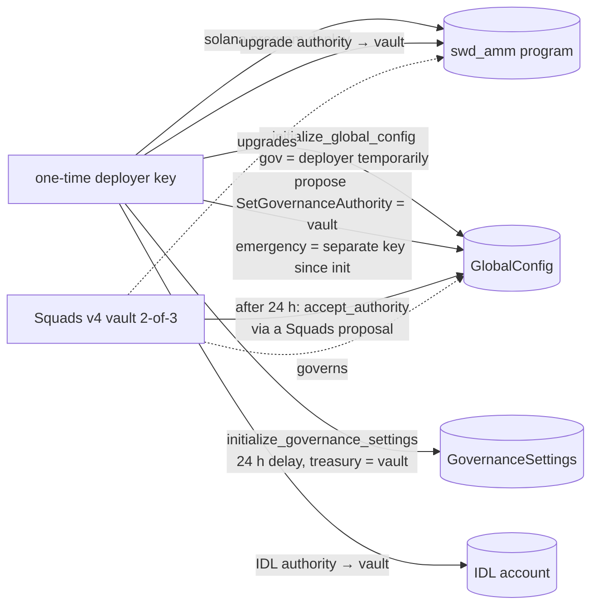

# Architecture — SWD AMM mainnet build (SWDMM v2 + governance)

SWDMM v2 is a **full-range constant-product pool** (x·y = k, no ticks) with the
fee features of Meteora DAMM v2: a scheduled base fee (fixed, time scheduler,
market-cap scheduler; linear or exponential decay), an optional volatility
(dynamic) fee, three fee-collection modes, delayed activation, LP positions as
program accounts (not NFTs) with claimable fees and an irreversible lock, a
per-swap and per-slot price-impact cap and an optional Pyth deviation guard.
Governance is a Squads v4 vault behind a 24–48 h timelock; a separate emergency
key can only pause. Product spec: `docs/SWDMM_V2.md`.

## Module map



## Accounts and PDAs

| Account | Seeds | Created by | Mutable by |
|---|---|---|---|
| `GlobalConfig` | `["global-config"]` | `initialize_global_config` (signer must be the program's **upgrade authority**) | governance (`set_pool_creation_paused`); `accept_authority` (signed by the NEW authority of a matured rotation action) |
| `GovernanceSettings` | `["gov_settings"]` | `initialize_governance_settings` (governance) | timelocked `SetProtocolFeeShare` / `SetTimelockDelay` / `SetTreasury`; `next_action_id` on every proposal |
| `PendingAction` | `["gov_action", id u64 LE]` | `propose_gov_action` (governance) | `cancel_gov_action` (governance), `emergency_cancel_unpause` (emergency, unpause kinds only), `execute_*` (anyone, after the delay, within 7 days), `accept_authority` (the new authority, rotation kinds only) |
| `MintPolicy` | `["mint_policy", mint]` | `set_mint_policy` (governance, `init_if_needed`) | `set_mint_policy` |
| `MintFeed` | `["mint-feed", mint]` | `set_mint_feed` (governance, `init_if_needed`) | `set_mint_feed` (existing pools copied the feed id; unaffected) |
| `SwdmmV2Pool` | `["swdmm_v2_pool", mint_a, mint_b, floor_fee_bps u16 LE]` | `initialize_v2_pool` (`mainnet` build: governance only, K-5; other builds: anyone unless creation is paused. Both mints need an enabled `MintPolicy`; neither vault may be born frozen) | pool instructions; emergency pause; timelocked unpause / params / fee withdrawal |
| vault A / B (token accounts) | `["swdmm_v2_vault", pool, mint]`, authority = pool PDA | `initialize_v2_pool` | only via pool-PDA-signed `transfer_checked` in `remove_v2_liquidity`, `claim_v2_fees`, `swap_v2`, `execute_withdraw_protocol_fees` |
| `SwdmmV2Position` | `["swdmm_v2_position", pool, index u64 LE]`, `index = sha256("swdmm_v2_position_index" ‖ owner ‖ nonce)[..8]` | `create_v2_position` (owner) | owner-gated instructions (`position.owner == signer && position.pool == pool`); closed by `close_v2_position` when empty |

Notes:

- A pair can have several pools, one per `floor_fee_bps` (fee tier). Mint order
  is not canonicalised on-chain; (A,B) and (B,A) are different pools.
- `reserve_a/b` are **tracked** in the pool account, never read from vault
  balances; donations to a vault only add surplus. Unclaimed LP fees and the
  protocol fee live in the vault next to the reserves (except in compounding
  mode, where the LP fee is added to the reserves).
- Positions bind their address to the owner (hash of owner + nonce) so nobody can
  pre-create the address an honest `create_v2_position` will use. Ownership after
  creation is a plain field (`transfer_v2_position`).

## Pool lifecycle

```mermaid
sequenceDiagram
  autonumber
  actor G as Governance (Squads vault)
  actor C as Pool creator
  actor L as LP
  actor T as Trader
  participant P as swd_amm
  G->>P: set_mint_policy(mint_a), set_mint_policy(mint_b)
  opt oracle guard wanted
    G->>P: set_mint_feed(mint, pyth_feed_id)
  end
  C->>P: initialize_v2_pool(params)  [mainnet: C is governance; devnet: creation not paused, or C is governance]
  C->>P: create_v2_position(nonce, index)
  C->>P: add_v2_liquidity(max_a, max_b, min_liquidity)  [first deposit: creator only, sets price, locks MINIMUM_LIQUIDITY]
  L->>P: create_v2_position + add_v2_liquidity (proportional quote)
  T->>P: swap_v2(amount_in, min_out, a_to_b)  [after activation_ts]
  Note over P: fee = scheduled base + volatility; LP fee → fee_per_liquidity<br/>(or reserves if compounding); protocol share → protocol_fee_a/b
  L->>P: claim_v2_fees / remove_v2_liquidity / lock_v2_liquidity
  L->>P: close_v2_position (only when empty)
```

## `swap_v2` step by step

```mermaid
flowchart TD
  A[checks: not swap_paused, now >= activation_ts,<br/>amount_in > 0, reserves > 0] --> B[price_before = reserve_b/reserve_a Q64.64]
  B --> C{same slot as impact_slot?}
  C -- no --> C1[record slot + price_before as slot reference]
  C -- yes --> D
  C1 --> D{oracle.enabled?}
  D -- yes --> D1[read both PriceUpdateV2: owner = Pyth receiver,<br/>Full verification, feed id, staleness, confidence;<br/>oracle price Q64.64]
  D -- no --> E
  D1 --> E[fee_bps = scheduled base fee + volatility fee, capped at 99%]
  E --> F[swdmm_math::swap: fee in A or B by collect mode,<br/>protocol share, new reserves, price impact]
  F --> G[require impact <= max_price_impact_bps,<br/>amount_out >= min_amount_out]
  G --> H[update fee_per_liquidity / protocol fees / stats / reserves]
  H --> I{same slot?}
  I -- yes --> I1[require cumulative slot impact <= cap]
  I -- no --> J
  I1 --> J{oracle?}
  J -- yes --> J1[enforce_guard(price_after):<br/>within max_deviation or moving toward oracle]
  J -- no --> K
  J1 --> K[update volatility state]
  K --> L[transfer_checked in: trader → vault<br/>transfer_checked out: vault → trader, pool PDA signs]
```

State is written before the token CPIs; the transaction is atomic, and the CPIs
go only to the token program recorded in the pool (`address = pool.token_program_x`).

## Governance and timelock



| Action (`GovAction`) | Executed by | Bounds checked |
|---|---|---|
| `UnpauseV2Pool { pool, swap, deposit, withdraw }` | `execute_v2_pool_action` | at least one flag; target pool must match |
| `SetV2PoolParams { pool, max_price_impact_bps, dynamic_fee_enabled }` | `execute_v2_pool_action` | cap in (0, 50%]; enabling the dynamic fee re-validates its params and resets volatility state |
| `WithdrawV2ProtocolFees { pool }` | `execute_withdraw_protocol_fees` | treasury token accounts must be owned by `settings.treasury` |
| `SetProtocolFeeShare { bps }` | `execute_settings_action` | ≤ 2,000 (20% of the fee) |
| `SetTimelockDelay { secs }` | `execute_settings_action` | 24 h–48 h on `mainnet` builds (5 s–48 h otherwise) |
| `SetTreasury { treasury }` | `execute_settings_action` | not the default key |
| `SetGovernanceAuthority { new_authority }` | `accept_authority`, **signed by `new_authority`** | not the default key, ≠ emergency (at propose and accept); proposer must still be governance at accept |
| `SetEmergencyAuthority { new_authority }` | `accept_authority`, **signed by `new_authority`** | **no delay** (executable at once); not the default key, ≠ governance |
| `UnpauseCpPool`, `UnpauseDlmmPool` | — | refused at proposal in `v2-only` builds (kept in the enum for layout stability) |

**Not timelocked (instant, governance signature):** `set_mint_policy`,
`set_mint_feed`, `set_pool_creation_paused`,
`initialize_governance_settings` (once), `propose_gov_action`, `cancel_gov_action`.
**Instant, emergency key:** `emergency_pause_v2_pool` (pause only),
`emergency_cancel_unpause`. See [TRUST_MODEL.md](TRUST_MODEL.md).

## Deployment and handover



`scripts/deploy-mainnet.sh` runs this order (dry run by default) and builds
`--features mainnet,v2-only`. Until the upgrade authority moves the deployer key is
all-powerful; it then stays governance until the vault accepts (≥ 24 h, the timelock);
see KNOWN_ISSUES K-9.
